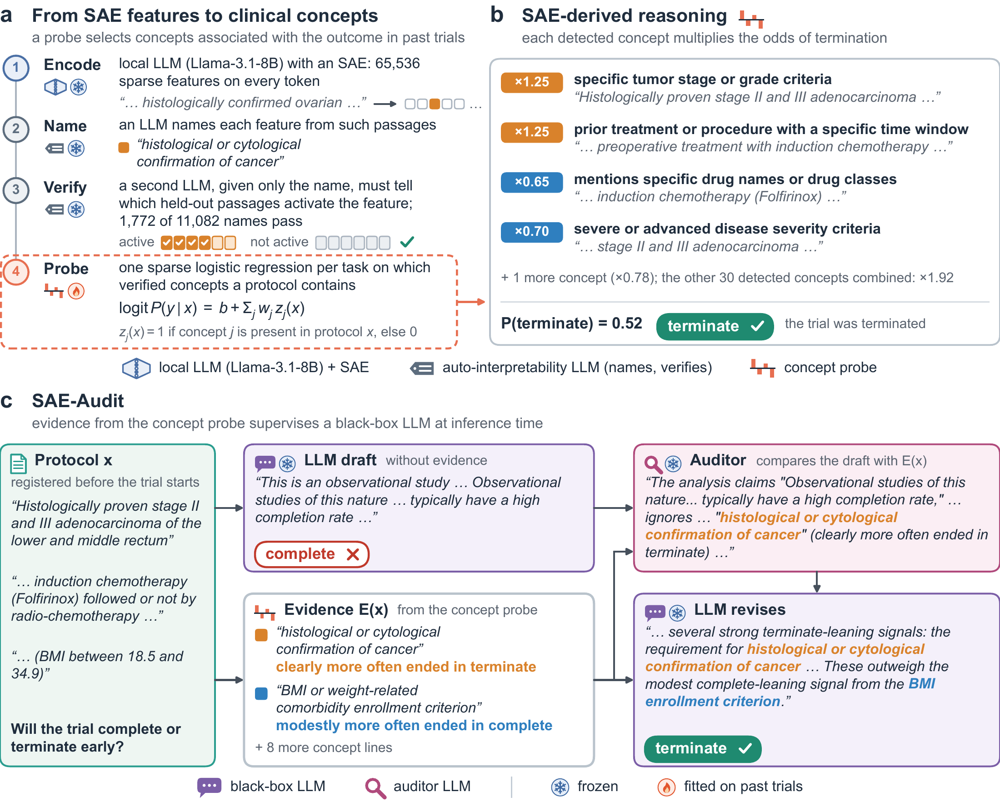

# SAE-Audit

Official code for **SAE-Audit: Clinical-Trial Prediction via Inference-Time Optimization of Black-Box LLMs Audited by Sparse Autoencoder Evidence**.

SAE-Audit improves a black-box LLM at inference time with evidence from a small open model. A frozen sparse autoencoder (SAE) on Llama-3.1-8B-Instruct is converted into a vocabulary of clinical concepts, each with a name that a second LLM has verified. A sparse probe fitted on past trials measures which concepts are associated with an outcome. For a new protocol, the detected concepts are written as evidence, each with the direction and strength of its association, and the LLM answers in the light of this evidence. No model is fine-tuned.

<p align="center">
  
</p>

## Installation

```bash
git clone https://github.com/JunboShen/SAE-Audit.git
cd SAE-Audit
pip install -e ".[data]"
```

The repository ships the concept vocabulary, the concept probes and the encoded protocols of the five tasks, so the steps below run on a CPU. Encoding new text needs a GPU, the `encode` extra (`pip install -e ".[data,encode]"`) and access to [Llama-3.1-8B-Instruct](https://huggingface.co/meta-llama/Llama-3.1-8B-Instruct) on the Hugging Face Hub.

## Quick start

**Evidence for a protocol.** The evidence is computed from the SAE concepts in the protocol and from past trials. No LLM is called.

```bash
python scripts/show_evidence.py --task completion --id test-10
```

```text
A frozen evidence model has indexed 6,000 registered protocols with known outcomes by the clinical concepts each
instantiates. Overall, 34% of them ended in terminate ... THIS protocol shows:
  [terminate-leaning (a task marker)] "The protocol requires a washout period free of radiotherapy or chemotherapy
  prior to enrollment." (...) -- 47% of the 538 registered protocols showing it ended in terminate, 13 points above
  the base -- evidence toward terminate
  [complete-leaning (a task marker)] "The trial is a comparative efficacy or safety study involving at least two
  proprietary medicinal..." (...) -- 21% of the 415 registered protocols showing it ended in terminate, 14 points
  below the base -- evidence toward complete
  ...
```

**Audit an LLM.** Any OpenAI-compatible endpoint works.

```bash
export SAE_AUDIT_API_BASE=https://api.deepseek.com/v1
export SAE_AUDIT_API_KEY=...
python scripts/prepare_data.py --task completion        # protocols from the public benchmark
python scripts/run_audit.py --task completion --model deepseek-v4-flash
```

**Audit your own protocol.** The protocol is encoded locally. Only the audited LLM is called through the endpoint.

```bash
python scripts/audit_protocol.py --task completion --protocol my_protocol.txt --model deepseek-v4-flash
```

**In Python.**

```python
from sae_audit import artifacts, audit
from sae_audit.encode import Encoder
from sae_audit.llm import LLM
from sae_audit.tasks import TASKS

task = TASKS["completion"]
model = artifacts.evidence_model("completion")      # concept probe and statistics of past trials
features = Encoder().features(protocol)             # SAE features of the protocol, from the local LLM
print(model.text(features))                         # the evidence E(x)

answer, runs = audit.audit(LLM("deepseek-v4-flash"), task, model, protocol, features,
                           summary=artifacts.summary("completion"), setting="draft_first")
```

## Results

Balanced accuracy (×100) on 250 test protocols per task, with deepseek-v4-flash as the audited LLM.

| Task | LLM alone | Concept probe | LLM + SAE-Audit | Improvement |
|---|:---:|:---:|:---:|:---:|
| Trial completion | 61.0 | 65.2 | **71.2** | +10.1 |
| Adverse events | 66.4 | 75.0 | **77.5** | +11.0 |
| Duration | 66.0 | 75.4 | **75.6** | +9.6 |
| Sample size | 57.2 | 67.5 | **67.6** | +10.4 |
| Dropout | 52.8 | 64.2 | **64.9** | +12.0 |

```bash
python scripts/prepare_data.py --task all
python scripts/run_audit.py --task all --model deepseek-v4-flash
```

Each task runs in the setting listed below, with three runs per protocol.

## Method

SAE-Audit has an offline stage and an online stage.

1. **Verified concepts.** Passages of past protocols are encoded with the SAE. An LLM names each feature from passages on which it is active, and a second LLM, given only the name, must pick out the held-out passages on which the feature is active. A feature is a concept if its name reaches a Matthews correlation coefficient of 0.7: 1,772 of 11,082 named features.
2. **Concept probe.** One sparse logistic regression per task on binary indicators of the concepts that a protocol contains.
3. **Evidence and audit.** For a new protocol, the evidence lists the detected concepts with the outcome each favours and the size of its effect, and states how past trials with similar concepts ended. The LLM uses it in one of two settings, each with an optional auditor that first relates the evidence to the protocol.

| Setting | Calls | Used for |
|---|---|---|
| draft-first: the LLM revises its own draft against the evidence | `d0 = LLM(x)`, `d1 = LLM(x, d0, E(x))` | trial completion, sample size |
| evidence-first: the LLM reads the evidence before it answers | `d1 = LLM(x, E(x))` | adverse events, dropout |
| evidence-first with the auditor | `a = Auditor(x, E(x))`, `d1 = LLM(x, E(x), a)` | duration |

`scripts/run_audit.py` takes `--setting` and `--auditor` to run any combination.

## Pipeline

Every step can be rerun from the public benchmarks. The encoded protocols, the vocabulary, the probes and the task summaries are released in `artifacts/`.

| Step | Script | Needs |
|---|---|---|
| Protocols, outcomes and splits | `scripts/prepare_data.py` | Hugging Face Hub |
| SAE features of the protocols | `scripts/encode_protocols.py` | GPU |
| Concept vocabulary | `scripts/build_vocabulary.py` | GPU, LLM endpoint |
| Concept probe | `scripts/fit_probe.py` | CPU |
| Task summary | `scripts/write_task_summary.py` | LLM endpoint |
| Evidence and audit | `scripts/show_evidence.py`, `scripts/run_audit.py` | LLM endpoint |

## Repository structure

```text
sae_audit/
  tasks.py        the five tasks: question, outcomes, prompt, setting
  data.py         protocols and outcomes from TrialPanorama and TrialBench
  encode.py       SAE features of a text (Llama-3.1-8B-Instruct, layer 19)
  vocabulary.py   naming and verification of SAE features
  probe.py        the sparse concept probe
  evidence.py     the evidence E(x)
  audit.py        the two settings, the auditor and the prompts
  selection.py    the selection step used with GPT-5.6-terra
  llm.py          client for an OpenAI-compatible endpoint
  artifacts.py    loaders for the released files
artifacts/
  vocabulary.json           11,082 named SAE features with their scores, 1,772 verified concepts
  descriptions.json         names and descriptions of the concepts shown in the evidence
  probes/                   the concept probe of each task
  task_summaries/           the task summary of each task
  features/                 the verified concepts present in every training and test protocol
  evaluation_ids.json       the 250 test protocols per task
scripts/                    command-line entry points
```

## Models and data

- SAE: [Goodfire/Llama-3.1-8B-Instruct-SAE-l19](https://huggingface.co/Goodfire/Llama-3.1-8B-Instruct-SAE-l19) on [meta-llama/Llama-3.1-8B-Instruct](https://huggingface.co/meta-llama/Llama-3.1-8B-Instruct)
- Trial completion and sample size: [TrialPanorama](https://huggingface.co/datasets/TrialPanorama/TrialPanorama-benchmark)
- Adverse events, duration and dropout: [TrialBench](https://huggingface.co/datasets/araag2/TrialBench)

## Citation

```bibtex
@article{shen2026saeaudit,
  title  = {SAE-Audit: Clinical-Trial Prediction via Inference-Time Optimization of Black-Box LLMs Audited by Sparse Autoencoder Evidence},
  author = {Shen, Junbo},
  year   = {2026}
}
```

## License

MIT
